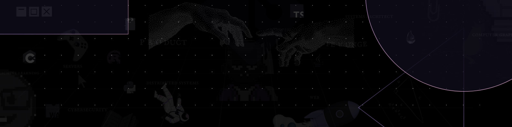

# **Information Technology Technician**

**fevunge | engineer | tlhc**  
    
    

---
## Skills

| **skill** | **technology** | **certificate** | **related projects** |
|-------|-----------|-------------|-------------------------|
|  **Systems Programming** | [C++](https://en.wikipedia.org/wiki/C%2B%2B), [Java](https://www.oracle.com/java/), [Go](https://go.dev/solutions/use-cases) | — | — |
|  **API (Auth, JWT, API Keys)** | [Hono](https://hono.dev/), [Spring Boot](https://spring.io/why-spring) | — | — |

## Training

- [42 School](https://www.42network.org/)

## Current Focus

- Next-Generation Fleet Management for African Markets
- My first RayCaster
- Gastronomy Consultancy

## GitHub Stats

